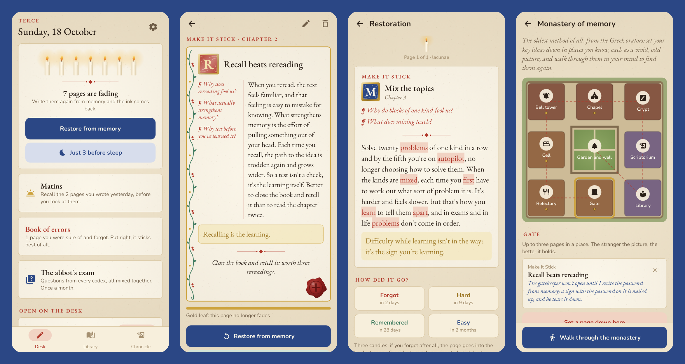

<div align="center">


# Scriptor

### In your own words. For life.

*A scriptorium for what you learn. After a book, a lecture or a video, write a page in your own words. Its ink fades along your forgetting curve, and you bring it back by writing it again from memory. Free, no ads, no account.*

[](https://github.com/bigdevwhale/scriptor/actions/workflows/android.yml)
[](https://github.com/bigdevwhale/scriptor/releases/latest)


[](LICENSE)

**English** · [Русский](README.ru.md) · [Changelog](CHANGELOG.md)



</div>

---

## The idea

Most of what we read or watch is gone within a week. What keeps it is not rereading but **retrieval**: putting it in your own words, then pulling it back out of memory at the right moments. Scriptor turns that into a quiet ritual at a scribe's desk instead of a deck of flashcards.

## How a page lives

1. **A codex for each source.** A book, a video, an article, a podcast, a lecture, a course. Before starting, write a **preface** (what you know and expect) and up to three **questions to the source**.
2. **A page in your own words.** Close the source and write from memory. Pasted text is the author's ink: it goes aside as a quotation, and the page stays yours. The page is laid out the Cornell way, with **questions on the margin** in cinnabar, a **golden line** for the essence and a **colophon** at the foot. You can also say it aloud.
3. **The ink fades.** Each page fades along its own forgetting curve (FSRS-4.5). The state of your memory is visible: fresh black pages, brown fading ones, the pale leather of a codex you've let go.
4. **Restoration.** Each restoration asks in a different way: rewrite it from memory, answer the margin questions, or fill the **lacunae** the mice ate. Before you look, **stake one to three candles** on being right. Then the page shows what you missed in cinnabar, and your grade bends the curve.
5. **The page blooms.** Restored once, it gets a painted **initial**. Two margin questions add **rubrics**. Answering the novice or giving two examples of your own makes **vines** climb the margin. Holding for half a year lays **gold leaf**. Putting it to use earns a **wax seal**.

## The learning science inside

| | Technique | In Scriptor |
|---|---|---|
| ✍️ | Generation effect | Pages in your own words; pasting goes to quotations |
| 🔁 | Retrieval practice and spacing | Fading ink, restorations scheduled by FSRS |
| 🔀 | Varied retrieval | Free recall, margin questions and lacunae in turn |
| 📜 | Pretesting, SQ3R | Preface and questions to the source, asked back when closing |
| 📐 | Cornell notes | Cue column on the margin, summary as the colophon |
| 🧒 | Feynman technique, protégé effect | The novice asks "why?", "an example?", "explain it to a ten-year-old" |
| 🌿 | Elaboration | Examples from your life, parables (analogies), disputes with the author |
| 🕯️ | Metacognition, hypercorrection | Candles staked before revealing; confident mistakes go into the **book of errors**; **the scribe's eye** shows your calibration |
| 🔔 | Sleep consolidation | **Compline**: a few fading pages before sleep. **Matins**: yesterday's pages recalled in the morning |
| 🗜️ | Summarising | Closing a codex: one sentence, then three words tooled on the spine |
| 🔏 | Transfer | The seal of practice: what you did with it |
| 🎨 | Dual coding | **Miniatures** drawn with a finger, and drawn again from memory |
| ⚖️ | Disputatio, steelmanning | Thesis, the strongest objections, a reply to each |
| 🧵 | Connecting ideas | **Red threads** between pages of different books, and their map |
| 🎓 | Interleaved testing | **The abbot's exam** once a month: mixed questions from every codex, first tell which book |
| 🏛️ | Method of loci | **The monastery of memory**: ideas set down in its places as vivid pictures, found again on a walk |

New techniques arrive as **crafts** that open as you go, so a new scribe starts with ink alone. Russian addresses you as he or she, your choice.

## Privacy

No account, no analytics, no ads, no network. Everything stays on the phone; a backup is one JSON file you save yourself. Speaking aloud uses the phone's own speech recogniser.

## Build

```bash
./gradlew assembleDebug                          # app.scriptor.dev
./gradlew assembleDebug -Pdemo                   # app.scriptor.demo with a scriptorium half a season in
./gradlew testDebugUnitTest -Prender [-Plang=ru] # draws the screens to app/build/art
python tools/icon.py                             # the launcher icon and docs/logo.png
```

Kotlin, Jetpack Compose, Room, DataStore. The forgetting curve is `domain/Memory.kt`; comparing a restoration with the page is `domain/Words.kt`. All the art (initials, vines, candles, seals, the novice, parchment) is drawn in code in `ui/art/Art.kt`. EB Garamond is under the SIL Open Font License.

## License

[MIT](LICENSE) · part of [Stillcraft](https://bigdevwhale.github.io/stillcraft/)
