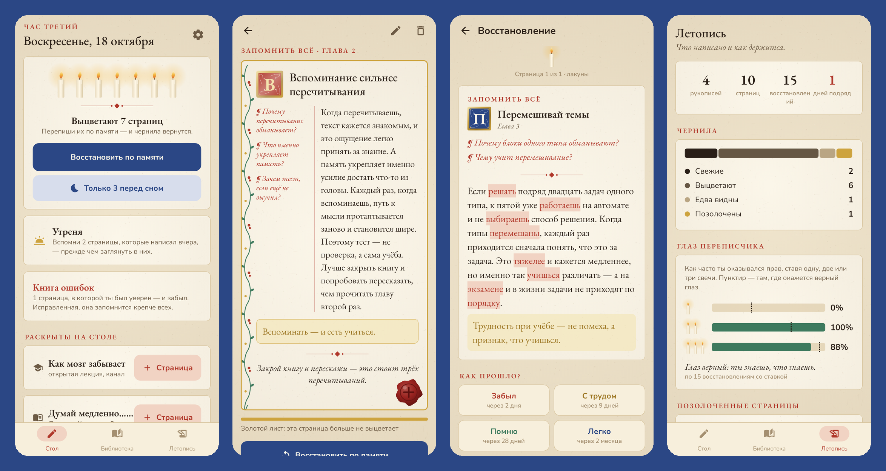

<div align="center">


# Scriptor

### Своими словами. На всю жизнь.

*Скрипторий для того, что ты узнал. После книги, лекции или видео напиши страницу своими словами. Её чернила выцветают по твоей кривой забывания, а вернуть их можно, переписав страницу по памяти. Бесплатно, без рекламы и аккаунта.*

[](https://github.com/bigdevwhale/scriptor/actions/workflows/android.yml)
[](https://github.com/bigdevwhale/scriptor/releases/latest)


[](LICENSE)

[English](README.md) · **Русский** · [Изменения](CHANGELOG.md)



</div>

---

## Идея

Большая часть прочитанного и просмотренного забывается за неделю. Удерживает знание не перечитывание, а **извлечение**: пересказать своими словами, а потом в нужные моменты доставать это из памяти. Scriptor превращает это в тихий ритуал за столом переписчика вместо колоды карточек.

## Как живёт страница

1. **Рукопись на каждый источник.** Книга, видео, статья, подкаст, лекция, курс. Перед началом пишешь **предисловие** (что знаешь и чего ждёшь) и до трёх **вопросов к источнику**.
2. **Страница своими словами.** Закрываешь источник и пишешь по памяти. Вставленный текст — это чернила автора: он уходит в цитату, а страница остаётся твоей. Страница устроена по Корнеллу: **вопросы на полях** киноварью, **золотая строка** с сутью и **колофон** внизу. Можно и рассказать вслух.
3. **Чернила выцветают.** Каждая страница выцветает по своей кривой забывания (FSRS-4.5). Состояние памяти видно глазами: свежие чёрные страницы, побуревшие, побледневшая кожа заброшенной рукописи.
4. **Восстановление.** Каждое восстановление спрашивает по-новому: переписать по памяти, ответить на вопросы с полей или заполнить **лакуны**, которые съели мыши. Пока не посмотрел, **ставишь от одной до трёх свечей** на то, что прав. Потом страница показывает забытое киноварью, а твоя оценка изгибает кривую.
5. **Страница расцветает.** После первого восстановления появляется расписная **буквица**. Два вопроса на полях дают **рубрики**. Ответ послушнику или два своих примера пускают по полю **вьюнок**. Полгода памяти кладут **сусальное золото**. Применил в жизни — получаешь **восковую печать**.

## Наука об учении внутри

| | Техника | В Scriptor |
|---|---|---|
| ✍️ | Эффект генерации | Страницы своими словами; вставка уходит в цитаты |
| 🔁 | Практика извлечения и интервалы | Выцветающие чернила, восстановления по FSRS |
| 🔀 | Вариативное извлечение | По очереди: свободный пересказ, вопросы с полей, лакуны |
| 📜 | Претест, SQ3R | Предисловие и вопросы к источнику, к ним возвращаешься при закрытии |
| 📐 | Конспект Корнелла | Колонка вопросов на полях, итог в колофоне |
| 🧒 | Техника Фейнмана, эффект протеже | Послушник спрашивает «почему?», «пример?», «объясни десятилетнему» |
| 🌿 | Элаборация | Свои примеры из жизни, притчи (аналогии), спор с автором |
| 🕯️ | Метапознание, гиперкоррекция | Свечи ставятся до проверки; уверенные ошибки идут в **Книгу ошибок**; **Глаз переписчика** показывает калибровку |
| 🔔 | Консолидация во сне | **Повечерие**: несколько выцветающих страниц перед сном. **Утреня**: вспомнить вчерашнее утром |
| 🗜️ | Сжатие | Закрытие рукописи: одно предложение, потом три слова на корешке |
| 🔏 | Перенос | Печать опыта: что ты с этим сделал |

## Приватность

Без аккаунта, аналитики, рекламы и сети. Всё хранится на телефоне; резервная копия — один JSON-файл, который ты сохраняешь сам. Голосовой ввод идёт через встроенный распознаватель речи телефона.

## Сборка

```bash
./gradlew assembleDebug                          # app.scriptor.dev
./gradlew assembleDebug -Pdemo                   # app.scriptor.demo со скрипторием, которому полсезона
./gradlew testDebugUnitTest -Prender [-Plang=ru] # рисует экраны в app/build/art
python tools/icon.py                             # иконка и docs/logo.png
```

Kotlin, Jetpack Compose, Room, DataStore. Кривая забывания — `domain/Memory.kt`, сравнение восстановления со страницей — `domain/Words.kt`. Вся графика (буквицы, вьюнки, свечи, печати, послушник, пергамент) нарисована кодом в `ui/art/Art.kt`. Шрифт EB Garamond распространяется по SIL Open Font License.

## Лицензия

[MIT](LICENSE) · часть [Stillcraft](https://bigdevwhale.github.io/stillcraft/)
